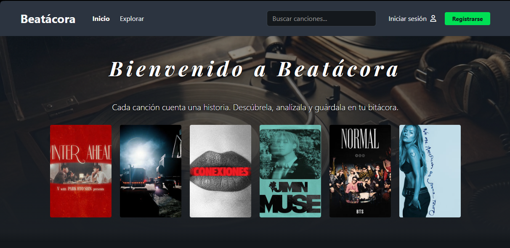
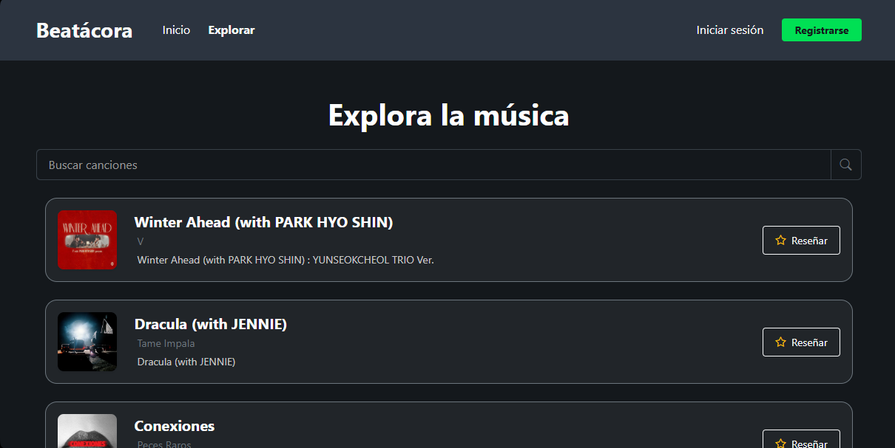
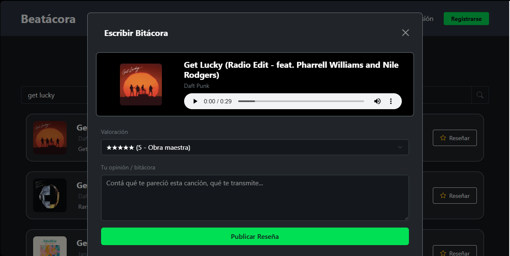
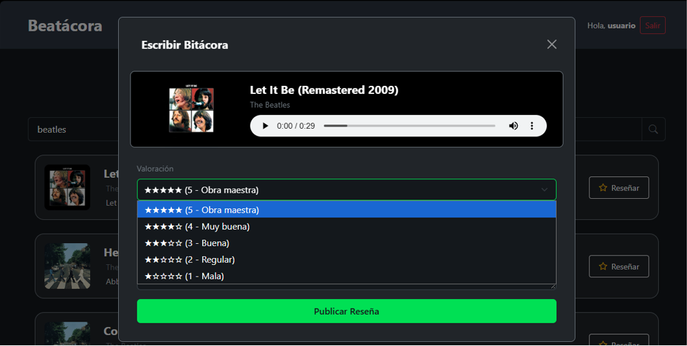
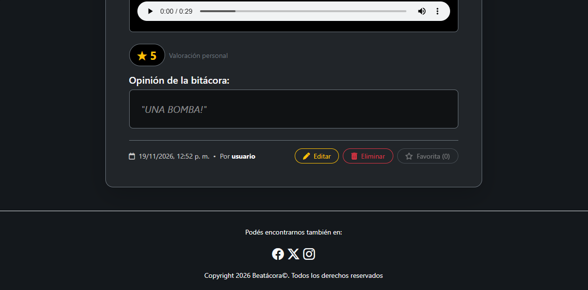

# Guía de uso
Beatácora · [http://localhost:3000] · v1.0.0

## ¿Para quién es?
Beatácora es un sitio web donde los usuarios pueden llevar un registro de las canciones que escuchan mediante reseñas con valoraciones y compartirlo con la comunidad.

## Primeros pasos
1. Levantá el servidor local ejecutando en la terminal :
                        "npm install" 
                        "cp .env.example .env" 
                        "npm run dev."
    Luego abrí `http://localhost:3000` en tu navegador.
2. En la pantalla principal ya podés explorar el feed de reseñas recientes o populares sin necesidad de configurar nada previo.
3.  **Acceso de prueba:** Al iniciar el servidor se crean automáticamente las siguientes cuentas para probar todas las funciones:
   * **Admin de prueba:** `admin@admin.com` / Contraseña: `123456`
   * **Usuario de prueba:** `usuario@usuario.com` / Contraseña: `123456`

## Tareas principales

### Explorar canciones, escuchar vistas previas y generar reseñas
1. Dirigite a la sección de **Explorar** (o utilizá la barra de búsqueda en la parte superior).

2. Buscá el título de una canción.
3. Hacé clic en el botón de **Reseñar** en la tarjeta de la canción y ahi te abre un modal para escuchar un fragmento de vista previa del audio directamente desde el navegador.

* **Si algo sale mal:**
  * *"No se encontraron canciones para tu búsqueda."*: Verificá que el nombre de la canción o del artista esté bien escrito o probá con una palabra clave más corta.
  * *"Error al buscar canciones"*: Algunas canciones del catálogo externo pueden no tener un fragmento de vista previa disponible; probá con otro tema de la lista.

  ### Publicar una reseña de una canción
1. Desde la vista de **Explorar**, con sesión iniciada, busca la canción que quieras reseñar y hace clic en el botón **Reseñar** para abrir el formulario modal.
2. Selecciona una puntuación de **1 a 5 estrellas**.
3. Escribí tu comentario o descripción personal sobre el tema.
4. Hace clic en **Publicar**. Tu reseña aparecerá inmediatamente en el listado principal.

* **Si algo sale mal:**
  * *"Completa este campo"*: Asegurate de escribir al menos un carácter.

### Editar o eliminar una reseña existente
1. Busca tu reseña en la pestaña “reseñas”. Selecciona donde dice “Ver reseña completa”.
2. Para **modificarla**: hace clic en el ícono o botón **Editar**, cambiá la puntuación de estrellas o el texto en el formulario y confirmá con **Publicar reseña **.
3. Para **borrarla**: hacé clic en **Eliminar** y confirmá la acción cuando el sistema te pida validación.

* **Si algo sale mal:**
  * *"No se pudo actualizar/eliminar la reseña"*: Es posible que la reseña ya haya sido eliminada en otra pestaña. Recargá la página (`F5`) para sincronizar el estado actual.

## Preguntas frecuentes
* **¿Por qué la página tarda varios segundos en cargar la primera vez que entro? **

  La aplicación está alojada en un servidor gratuito que entra en modo de reposo tras un período de inactividad. La primera petición puede demorar entre 30 y 50 segundos mientras el servicio vuelve a iniciarse; luego funciona con normalidad.
* **¿Puedo escuchar la canción sin estar registrado? **

  Sí, totalmente, podes el escuchar el fragmento de la canción sin estar registrado ni logueado en la página.
* **¿Puedo escuchar las canciones completas? **

  No, Beatácora ofrece fragmentos de vista previa para identificar y evaluar la canción mientras redactás tu reseña.
* **¿Puedo publicar más de una reseña? **

  Sí, podés crear todas las reseñas que quieras sobre distintas canciones del catálogo.

## Contacto
Si encontrás algún error o tenés sugerencias sobre la plataforma, podés escribirnos a **[beatacora@hotmail.com]**. 
